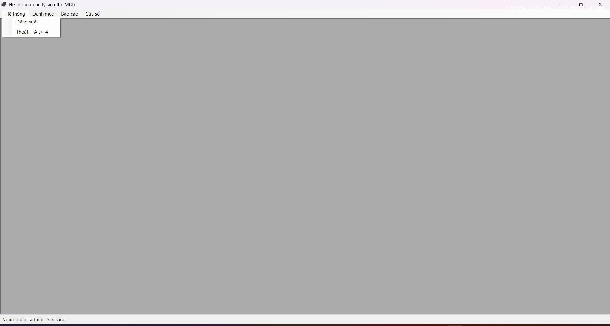
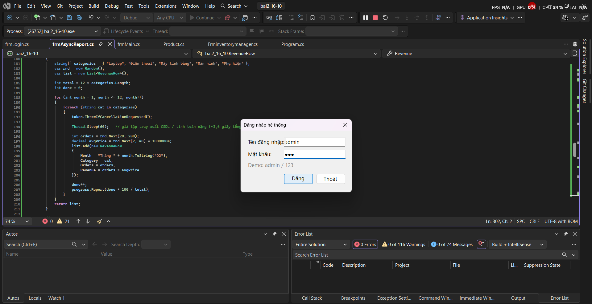
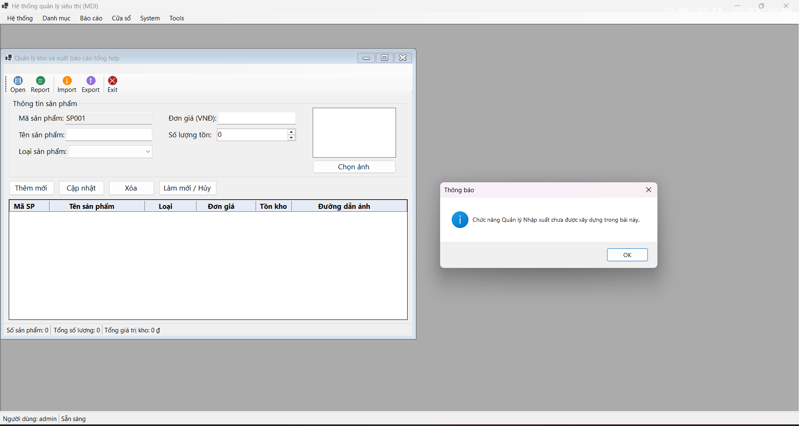
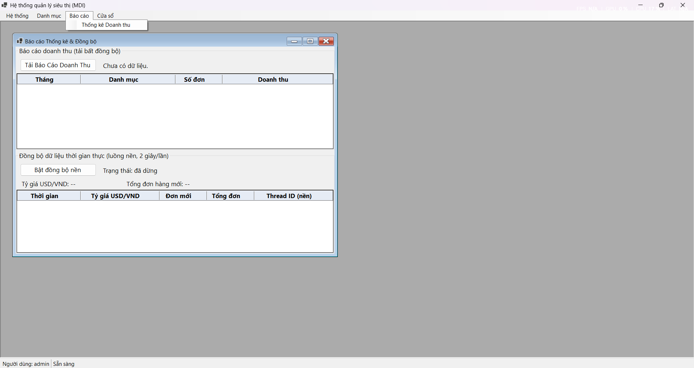
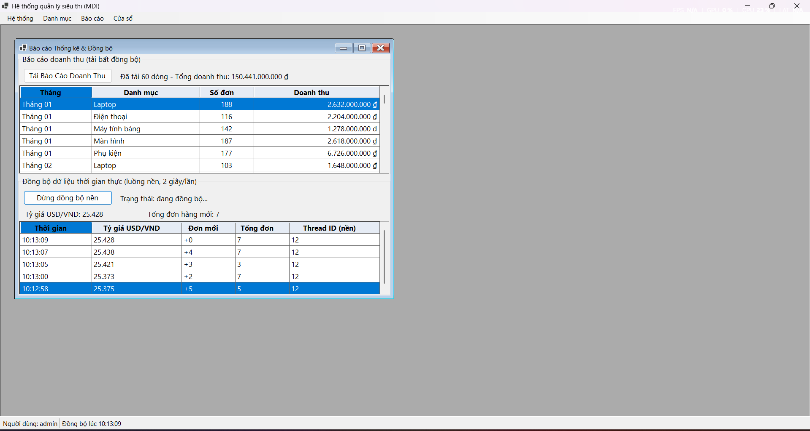

# BÁO CÁO BÀI TẬP / ĐỒ ÁN

## THÔNG TIN SINH VIÊN

- **Họ và tên:** Nguyễn Trung Hiếu
- **Mã số sinh viên:** 24810310212
- **Lớp:** D19CNPM3
- **Tên môn học:** Lập trình C# / Windows Forms
- **Tên bài tập:** bai3 ngày 16/10

---

## KẾT QUẢ THỰC HÀNH

### 1. Ảnh màn hình Giao dien 
    

### 2. Ảnh màn hình khi đăng nhập

### 4.  Ảnh màn hình quản lí kho hàng 

### 5.  Ảnh màn hình sau khi thông kê báo cáo

### 6.  Ảnh màn hình khi tải báo cáo và bật đồng bộ

